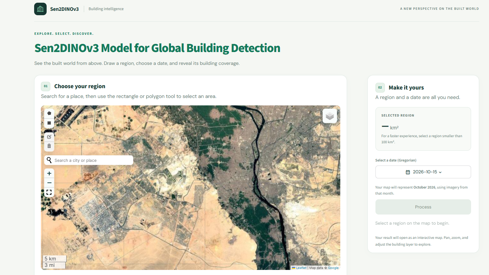

# 🛰️ Sen2DINOv3

### Global building-footprint mapping from 10 m Sentinel-2 imagery

**A multispectral DINOv3 adaptation with LoRA and UPerNet**  
Research code · S12OpenBuilding benchmark · Interactive geospatial demo

[Overview](#overview) · [Results](#results) · [Models](#model-zoo) · [Quick start](#quick-start) · [Demo](#interactive-demo)

  
   Qualitative building-footprint predictions from the study. Select the image to enlarge.

## Overview

**Sen2DINOv3** adapts a satellite-pretrained DINOv3 vision transformer to **12-band Sentinel-2** imagery for binary building-footprint segmentation. A learned spectral adapter bridges the multispectral input, LoRA makes encoder adaptation parameter-efficient, and a UPerNet decoder produces spatial masks.

**Reported in the manuscript:** **80.37% Dice** · **67.15% IoU** · **84.47% recall** · approximately **14M trainable parameters**.

`12 Sentinel-2 bands` → `Spectral adapter (12 → 36 → 3)` → `DINOv3 + LoRA` → `UPerNet` → `Building mask`

### S12OpenBuilding dataset

The companion dataset is described as **111,709 image patches** across **1,492 regions on four continents**. Each patch is 224 × 224 pixels, with 12 Sentinel-2 bands represented at 10 m resolution. Building labels are based on confidence-filtered Google Open Buildings V3 footprints; the study describes a region-level 80:20 train/test split.

  
   Geographic coverage and sample regions from S12OpenBuilding.

## Results

<table>
  <thead>
    <tr><th align="left">Architecture</th><th align="center">Dice ↑</th><th align="center">IoU ↑</th><th align="center">Recall ↑</th></tr>
  </thead>
  <tbody>
    <tr><td align="left"><strong>Sen2DINOv3 (ours)</strong></td><td align="center"><strong>80.37%</strong></td><td align="center"><strong>67.15%</strong></td><td align="center"><strong>84.47%</strong></td></tr>
    <tr><td align="left">Panopticon-LoRA</td><td align="center">77.72%</td><td align="center">63.54%</td><td align="center">82.04%</td></tr>
    <tr><td align="left">DOFA-LoRA</td><td align="center">77.31%</td><td align="center">63.02%</td><td align="center">81.39%</td></tr>
    <tr><td align="left">U-Net++</td><td align="center">77.05%</td><td align="center">64.29%</td><td align="center">80.02%</td></tr>
    <tr><td align="left">DINOv3-LoRA</td><td align="center">75.12%</td><td align="center">60.16%</td><td align="center">80.27%</td></tr>
    <tr><td align="left">MAE-SSL4EO-LoRA</td><td align="center">73.05%</td><td align="center">57.58%</td><td align="center">77.60%</td></tr>
    <tr><td align="left">SegFormer</td><td align="center">72.65%</td><td align="center">57.35%</td><td align="center">80.46%</td></tr>
    <tr><td align="left">DeepLabV3+</td><td align="center">61.48%</td><td align="center">44.59%</td><td align="center">62.38%</td></tr>
  </tbody>
</table>

Figures reproduce selected **manuscript-reported** results, not results rerun from this repository. The study does not supply repeated-trial statistics here; interpret model differences accordingly.

## Model zoo

This release includes the supplied **architecture implementations and training utilities**—not pretrained model checkpoint files.

<table>
  <thead>
    <tr><th align="left">Family</th><th align="center">Implementation</th></tr>
  </thead>
  <tbody>
    <tr><td align="left"><strong>Sen2DINOv3</strong></td><td align="center"><a href="models/Sen2DINOv3.py"><code>Sen2DINOv3.py</code></a></td></tr>
    <tr><td align="left"><strong>DOFA-LoRA</strong></td><td align="center"><a href="models/DOFA.py"><code>DOFA.py</code></a></td></tr>
    <tr><td align="left"><strong>Panopticon-LoRA</strong></td><td align="center"><a href="models/Panopticon.py"><code>Panopticon.py</code></a></td></tr>
    <tr><td align="left"><strong>MAE-SSL4EO / MAE-SSL4EO-LoRA</strong></td><td align="center"><a href="models/MAE_SSL4EO.py">MAE</a> · <a href="models/MAE_SSL4EO_LORA.py">MAE + LoRA</a></td></tr>
    <tr><td align="left"><strong>DeepLabV3+ / SegFormer / U-Net++</strong></td><td align="center"><a href="models/DeepLabV3Plus.py">DeepLabV3+</a> · <a href="models/SegFormer.py">SegFormer</a> · <a href="models/UNetPlusPlus.py">U-Net++</a></td></tr>
  </tbody>
</table>

The `models/` package also contains shared [spectral adapters](models/adapters.py), [UPerNet components](models/upernet.py), and [Sentinel-2 wavelength metadata](models/wavelengths.py). Model and training presets are defined in [`configs.py`](configs.py). The root-level [`experiments.py`](experiments.py) is a setup helper: it loads the chosen backbone, constructs the model, and configures the optimizer, loss, scheduler, and metrics.

<strong>Repository layout</strong>

~~~text
Sen2DINOv3/
├── models/              # Architectures, adapters, UPerNet, wavelengths
├── assets/              # Figures and demo screenshot
├── configs.py           # Experiment presets and hyperparameters
├── experiments.py       # Backbone loading and optimizer setup
├── train.py             # Training and validation loops
├── losses.py            # Dice + binary cross-entropy
├── early_stopping.py    # MAE early-stopping utility
├── requirements.txt     # Python dependencies
├── .editorconfig        # Editor formatting conventions
├── .gitignore           # Local outputs excluded from Git
└── README.md
~~~

## Quick start

**1 · Install** (Python 3.11+ recommended)

~~~bash
git clone https://github.com/MehdiGolkarAmoli/Sen2DINOv3.git
cd Sen2DINOv3
pip install -r requirements.txt
~~~

**2 · Build Sen2DINOv3 and train** using your own Sentinel-2 dataloaders (this is a usage template, not a standalone script):

~~~python
from configs import EXPERIMENTS
from experiments import build_model, configure_training
from train import train_model

name = "Sen2DINOv3"
config = EXPERIMENTS[name]
model = build_model(name)
training = configure_training(model, config)

# Supply train_loader and val_loader from your dataset pipeline.
history = train_model(
    model, train_loader, val_loader,
    checkpoint_dir="checkpoints/Sen2DINOv3",
    config=config, **training,
)
~~~

**Input contract:** images should be `[B, 12, H, W]`; binary masks should be `[B, 1, 224, 224]` for the documented experiments. The configuration's `input_size` describes the image size expected from your loader; training aligns prediction logits to the target mask grid. The Sen2DINOv3 preset uses 512-pixel imagery.

> **Before running:** This code does not include a dataset download/preprocessing pipeline, geographic split files, or trained segmentation checkpoints. Backbone weights are loaded via Transformers/TorchGeo and may require network access and appropriate model permissions. The dependency list is not a fully locked CUDA environment.

## Interactive demo

Try the **currently available Sen2DINOv3 demo** directly in your browser:

**[🚀 Launch the Sen2DINOv3 interactive demo](https://01a1c9af-de96-c0f8-51a8-07262ff0522d.share.connect.posit.cloud/)**

The web app lets you select a geographic location and imagery date to explore building-footprint mapping from Sentinel-2 satellite imagery. It provides a convenient way to inspect the model's geospatial predictions without setting up the research code locally.

  
   Select the screenshot to open the current demo.
    
  

> **Demo availability:** Two previously shared deployments — [Demo 1](https://01a1b9c6-ffd8-46e3-32ce-b7568075d81c.share.connect.posit.cloud/) and [Demo 2](https://01a1a747-710b-3809-a63e-588361d71177.share.connect.posit.cloud/) — **may have expired or become inactive**. These older links are kept for reference, but the **[current demo](https://01a1c9af-de96-c0f8-51a8-07262ff0522d.share.connect.posit.cloud/)** is now available. Posit Connect Cloud deployments may be subject to hosting or usage limits.

## Research & attribution

**S12OpenBuilding: Global Building Footprint Mapping via Sen2DINOv3, a Parameter-Efficient Adaptation of DINOv3 to Sentinel-2 Imagery**

Mehdi Golkar Amoli · Mahdi Hasanlou · Mahdi Panahi
