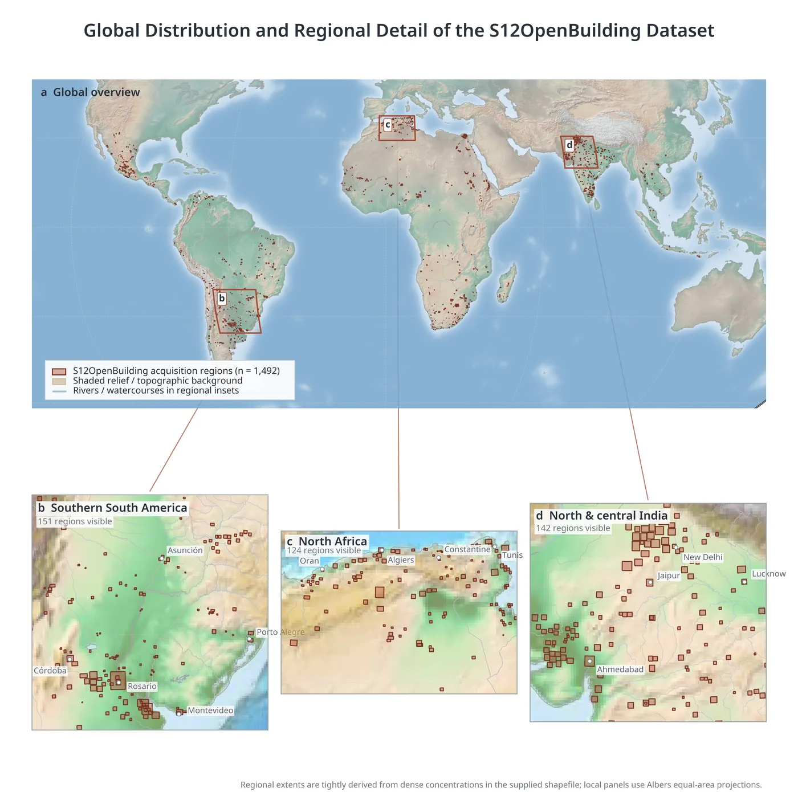
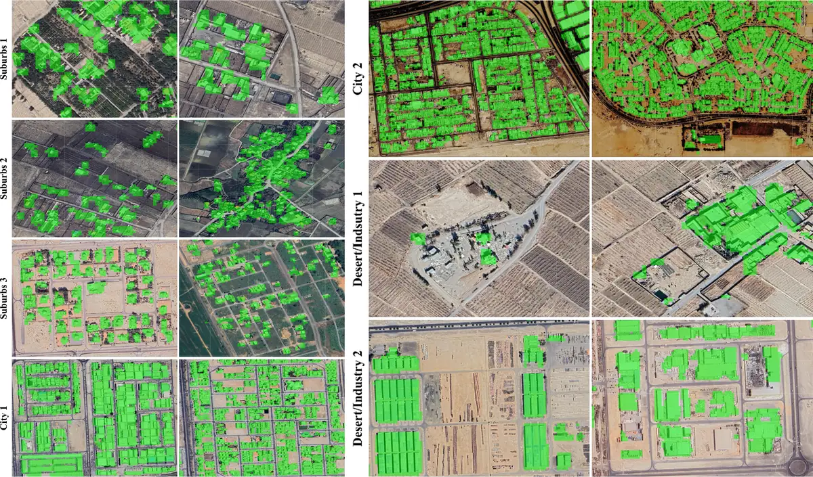

# Sen2DINOv3

**Global building-footprint mapping from 10 m Sentinel-2 imagery using a parameter-efficient adaptation of DINOv3.**

  

Click the figure to open the full-resolution image.

<em>Figure 3. Global distribution and regional detail of the S12OpenBuilding dataset.</em>

## 🛰️ Project summary

Sen2DINOv3 detects building footprints globally from 10 m Sentinel-2 imagery by adapting the DINOv3 satellite vision encoder to multispectral inputs.  
This repository accompanies the S12OpenBuilding dataset and presents the model, evaluation results, and interactive demo.

## 🗺️ S12OpenBuilding dataset

S12OpenBuilding contains **111,709** patches from **1,492 regions across four continents**, each with 224 × 224 pixels and 12 Sentinel-2 bands at 10 m resolution.  
Building masks are derived from confidence-filtered **Google Open Buildings V3** footprints and aligned to the Sentinel-2 grid; the article uses a region-level 80:20 train/test split.

## 🚀 Main contributions

- 🌍 **Global dataset:** a geographically diverse building-footprint dataset designed for Sentinel-2 imagery.
- 🧠 **Foundation-model adaptation:** a learned multispectral input interface and parameter-efficient adaptation of DINOv3-sat493M.
- 🛰️ **Interactive demonstration:** a web app for exploring building detection across user-selected regions and dates.

## 🧠 Sen2DINOv3 at a glance

**12-band Sentinel-2 → learned spectral adaptation → DINOv3-sat493M with LoRA → UPerNet-based decoder → building mask.**  
The best configuration achieves **80.37% Dice**, **67.15% IoU**, and **84.47% Recall**, with approximately **14 million trainable parameters**.

## 📊 Quantitative results

The following table reproduces **Table 3** from the article. Dice, IoU, and Recall are reported in percent; trainable parameters are reported in millions.

| Model | Dice (%) | IoU (%) | Recall (%) | Trainable params (M) |
|---|---:|---:|---:|---:|
| U-Net++ | 77.05 | 64.29 | 80.02 | 49 |
| DeepLabv3 | 51.41 | 35.02 | 51.99 | 40 |
| DeepLabv3+ | 61.48 | 44.59 | 62.38 | 27 |
| PSPNet | 74.76 | 59.68 | 80.24 | 25 |
| SegFormer | 72.65 | 57.35 | 80.46 | 25 |
| Mask2Former | 72.49 | 56.88 | 80.20 | 216 |
| MAE-SSL4EO | 70.11 | 54.12 | 70.28 | 10 |
| MAE-SSL4EO-LoRA | 73.05 | 57.58 | 77.60 | 12 |
| Panopticon-LoRA | 77.72 | 63.54 | 82.04 | 10 |
| DOFA-LoRA | 77.31 | 63.02 | 81.39 | 14 |
| DINOv3-Frozen | 62.08 | 45.13 | 65.98 | 10 |
| DINOv3-LoRA | 75.12 | 60.16 | 80.27 | 14 |
| **Sen2DINOv3 (ours)** | **80.37** | **67.15** | **84.47** | **14** |

**Best reported result:** Sen2DINOv3 achieves the highest Dice, IoU, and Recall among the listed methods. Its Dice score is 3.32 percentage points above U-Net++, with 14M rather than 49M trainable parameters.

*The manuscript reports single-run model comparisons; repeated-trial statistical analysis is not provided.*

## 🔎 Qualitative examples

Figure 17 compares Sen2DINOv3 predictions with Google Earth very-high-resolution imagery across suburban, urban, and desert/industrial settings.  
These examples provide a visual assessment rather than a separate quantitative evaluation; limitations include small-building omissions, uncertain 10 m boundaries, and false detections over bright surfaces.

  

Click the figure to open the full-resolution image.

<em>Figure 17. Detailed visual comparison of building masks generated by Sen2DINOv3 with Google Earth VHR imagery across representative suburban, urban, and desert/industrial regions.</em>

## 🖥️ Demo application

Select a region on the map, choose an image date, and run Sen2DINOv3 to explore its building-detection results.

  

  <a href="https://01a1a747-710b-3809-a63e-588361d71177.share.connect.posit.cloud/"><strong>🚀 Launch the Sen2DINOv3 Demo</strong></a>

## 📦 Code, weights, and data availability

This repository currently provides the project overview, manuscript figures, evaluation results, and live demo. Training/inference code, pretrained weights, and S12OpenBuilding download instructions will be added when they are ready for public release.

## 📄 Article

**S12OpenBuilding: Global Building Footprint Mapping via Sen2DINOv3, a Parameter-Efficient Adaptation of DINOv3 to Sentinel-2 Imagery**

**Authors:** Mehdi Golkar Amoli, Mahdi Hasanlou, Mahdi Panahi, and Saeid Homayouni.

---

**Repository:** [MehdiGolkarAmoli/Sen2DINOv3](https://github.com/MehdiGolkarAmoli/Sen2DINOv3) · **Demo:** [Open the app](https://01a1a747-710b-3809-a63e-588361d71177.share.connect.posit.cloud/)
